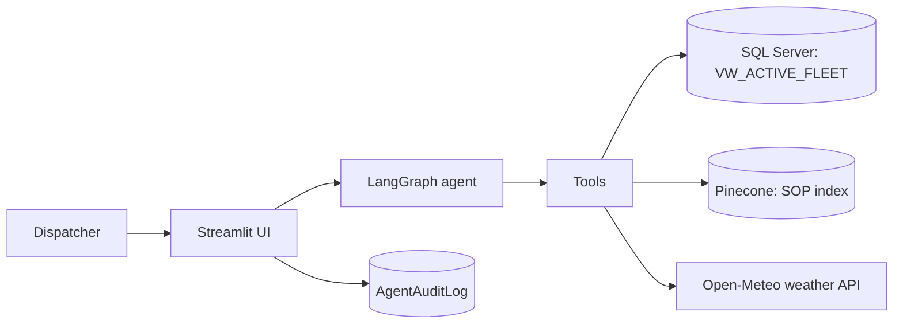

# Cold-Chain Logistics AI Assistant

A conversational compliance agent for cold-chain dispatchers. A dispatcher asks a question in plain English, and a LangGraph agent decides which tools to call: live fleet telemetry from a legacy SQL Server, corridor weather, and the company's Standard Operating Procedures (SOPs). The answer comes back with the source of each fact, and every step is written to an audit log.

**Live demo:** _add link after deployment_

## The problem

When a driver reports a temperature drift, the dispatcher has to query databases and dashboards by hand, search the SOP documents for the right rule, and then carry out an escalation. Every minute lost can mean spoiled cargo, and SOPs change often, so people can end up following outdated rules.

The data also lives in a legacy SQL Server that nobody wants to rebuild, and an AI agent must never be able to change or delete anything in it.

## What it does

Example questions:

- "Find any active shipments near Los Angeles (Latitude ~33.8, Longitude ~-118.1). Check the local weather there, and tell me if the current cargo temperature violates the SOP for fresh perishables."  
  The agent queries the fleet view, fetches live weather, searches the SOP, and combines the three into one answer.
- "Explain the difference between a Tier 1 and Tier 2 escalation."  
  The agent searches the SOP only. It does not touch the database or the weather API, and it says so when the SOP does not define something.

## Architecture



- **Presentation:** Streamlit chat page plus an admin screen that reads the audit log.
- **Orchestration:** a LangGraph agent loop. The reasoner (LLM) decides whether to call a tool, the tool node runs it, and the loop ends when no more tools are needed.
- **Tools:** `query_telemetry_db` (read-only SQL), `fetch_corridor_conditions` (live weather), `search_compliance_sop` (vector search over SOPs).
- **LLM:** DeepSeek (`deepseek-v4-flash`) through an OpenAI-compatible client. A local Ollama model (`qwen2.5:7b`) is available as a free fallback.
- **Embeddings:** `BAAI/bge-m3` running locally (1024 dimensions). An OpenAI option is also supported and uses a separate Pinecone index.

## Security design

- The agent connects as a dedicated read-only user, `USR_FDE_RO`. It can only select from the view `FDE_VIEWS.VW_ACTIVE_FLEET`, and access to the raw legacy table is denied.
- The SQL tool refuses anything that is not a `SELECT`.
- The agent user can only `INSERT` into `FDE_VIEWS.AgentAuditLog`. It cannot update or delete log rows, so the trail is append-only.
- Every tool call and the final answer is logged with a session ID, node name, tool name and content. The admin screen shows the log after authentication.
- The database port is not exposed to the internet. In development it is reached through an SSH tunnel.

## Tech stack

Python, LangGraph, LangChain, Streamlit, SQL Server 2022 (Docker), SQLAlchemy and pyodbc, Pinecone, sentence-transformers (`bge-m3`), DeepSeek API, Open-Meteo, AWS EC2.

## Repository structure

```
.
|-- data/
|   |-- raw/        dataset CSV (ingested into SQL Server)
|   |-- policy/     SOP documents (ingested into Pinecone)
|   `-- source/     data.txt with the dataset link
|-- scripts/
|   |-- ingest_legacy_data.py        load the CSV into SQL Server
|   |-- ingest_sop_pinecone.py       chunk, embed and index the SOPs
|   |-- setup_security_and_view.sql  read-only user and fleet view
|   `-- create_audit_log.sql         append-only audit table
|-- src/
|   |-- agent_tools.py   the three tools
|   |-- orchestrator.py  LangGraph agent
|   |-- ui.py            Streamlit app
|   `-- prompts/         system prompt
`-- .streamlit/          Streamlit config
```

## Running it locally

**Prerequisites:** Python 3.12, Microsoft ODBC Driver 18 for SQL Server, an AWS EC2 instance (or any host) running SQL Server in Docker, a Pinecone account, and a DeepSeek API key.

**1. Start SQL Server in Docker on the server**

```bash
docker run -v mssql_data:/var/opt/mssql \
  -e "ACCEPT_EULA=Y" \
  -e "MSSQL_SA_PASSWORD=<sa_password>" \
  -p 1433:1433 --restart unless-stopped \
  --name legacy-mssql \
  -d mcr.microsoft.com/mssql/server:2022-latest
```

Keep port 1433 closed in the security group and reach it through an SSH tunnel from your machine:

```bash
ssh -i <key.pem> -N -L 127.0.0.1:1433:localhost:1433 ubuntu@<EC2_PUBLIC_IP>
```

**2. Install dependencies**

```bash
python -m venv venv
venv\Scripts\activate      # Windows
pip install -r requirements.txt
```

**3. Create `.env`** (never commit it)

| Variable                               | Purpose                                      |
| -------------------------------------- | -------------------------------------------- |
| `SQL_SERVER_HOST`, `SQL_SERVER_PORT`   | `127.0.0.1` and `1433` when using the tunnel |
| `SQL_ADMIN_USER`, `SQL_ADMIN_PASSWORD` | admin login for setup and the audit screen   |
| `SQL_AGENT_USER`, `SQL_AGENT_PASSWORD` | read-only agent login                        |
| `PINECONE_API_KEY`                     | vector database                              |
| `DEEPSEEK_API_KEY`                     | LLM                                          |
| `Agent_llm`                            | `DEEPSEEK`, `OPENAI` or `OLLAMA`             |
| `Embeddings_model`                     | `LOCAL` or `OPENAI`                          |

**4. Load data and build the database objects**

```bash
python scripts/ingest_legacy_data.py
python scripts/ingest_sop_pinecone.py
```

Then run `scripts/setup_security_and_view.sql` and `scripts/create_audit_log.sql` against the server as the admin user. Change the demo password for `USR_FDE_RO` in the SQL file first.

**5. Run**

```bash
python src/agent_tools.py      # smoke-test the three tools
python src/orchestrator.py     # command-line chat
streamlit run src/ui.py        # web UI on http://localhost:8501
```

## Deployment

The app runs on a single AWS EC2 instance (`c7i-flex.large`, Ubuntu, 30 GB disk, eu-north-1):

- SQL Server 2022 runs in Docker on the instance with a persistent volume and a restart policy.
- The Streamlit app runs as a `systemd` service on port 8501, so it starts on boot and restarts if it crashes.
- The app connects to the database over `127.0.0.1`. Port 1433 is closed to the internet.
- Port 8501 is opened in the security group only while the app is being demoed.
- Python 3.12 is installed with `uv` and a 4 GB swap file is configured, because the embedding model and SQL Server share 4 GB of RAM.
- Microsoft ODBC Driver 18 is installed from Microsoft's package repository.
- Secrets live in a `.env` file on the server (permissions `600`) and never in Git.

## Design decisions

- **Purpose-built tools instead of free text-to-SQL.** A fixed set of tools over a read-only view limits what the agent can do and keeps behavior predictable.
- **Least privilege at the database layer.** Security is enforced by SQL permissions, so it holds even if the model is manipulated by a prompt.
- **Honest answers over confident ones.** The agent states when the SOP does not cover a question, instead of inventing a policy.

## Limitations

- The SOP corpus is a single document, so some definitions (for example Tier 1 escalation) are not covered.
- The dataset is synthetic, so the readings are not real shipments.
- The weather tool derives a congestion index from wind speed only, which is a simplification.

## Acknowledgements

- Dataset: "Logistics and supply chain dataset" by datasetengineer on Kaggle (see `data/source/data.txt`). Check the dataset's license before reuse.

**Live demo:** deployed on AWS EC2 and started on request (the server is stopped when idle to save cost). A recorded walkthrough is available on request.
